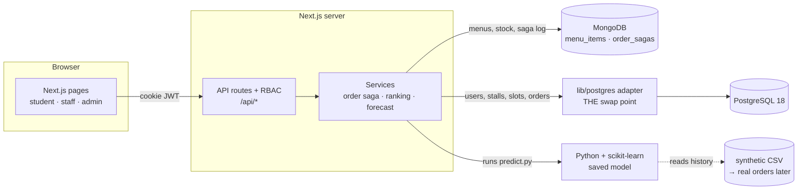

# CampusBite 🍴: Smart Canteen Pre-Order & Queue Management

Students pre-order food from campus stalls and book a 10-minute pickup slot. Stalls see orders coming in and tomorrow's forecast. The system prevents overbooking, keeps two databases consistent, and ranks stalls so students aren't pushed toward an overloaded one.

> This repo contains **Person 2's part** (menu + app + intelligence). Person 1's PostgreSQL work plugs in through one clearly marked adapter. See [docs/INTEGRATION_CONTRACT.md](docs/INTEGRATION_CONTRACT.md).

## Architecture



## Who owns what

| Area | Person 2 (this repo) | Person 1 |
|---|---|---|
| MongoDB menus, validation, indexes, seed, explain | ✅ | |
| Next.js APIs, auth (bcrypt + JWT + RBAC) | ✅ | |
| Student / staff / admin UI | ✅ | |
| Order saga (cross-DB consistency) | ✅ | shared (the Postgres side) |
| ML forecasting + demand-aware ranking | ✅ | |
| PostgreSQL schema, constraints, triggers | placeholder only (`db/placeholder_schema.sql`) | ✅ |
| Slot booking: transactions, row locks, isolation levels | placeholder only | ✅ |
| Postgres query optimization (EXPLAIN ANALYZE), concurrency tests | | ✅ |
| End-to-end testing | shared: [checklist](docs/INTEGRATION_CONTRACT.md#5-shared-end-to-end-test-checklist-do-together) | shared |

## Folder map (separate folders = fewer merge conflicts)

```
app/                 Next.js pages + API routes (api/auth, menu, stalls, orders, admin, forecast…)
components/          React UI pieces
lib/auth/            bcrypt, JWT, RBAC guard, rate limit
lib/mongo/           client, schemas+validator, indexes, menuRepo, sagaRepo
lib/postgres/        ★ PgAdapter interface + placeholder adapter (Person 1 swaps here)
lib/services/        orderSaga, ranking, forecast bridge
ml/                  synthetic data, training, prediction, pytest tests
db/                  placeholder_schema.sql  (Person 1 replaces)
scripts/             seed-mongo, explain-mongo, setup-postgres, reconcile
docs/                INTEGRATION_CONTRACT · CONSISTENCY_DESIGN · VIVA_NOTES
tests/               vitest: auth, menu APIs, saga, ranking
```

## Setup on macOS (first time)

You already have PostgreSQL 18. Check each step with the command in the last column.

| # | Step | Command | Check |
|---|---|---|---|
| 1 | Homebrew packages | `brew install node python@3.12` | `node -v` (≥ 20) |
| 2 | MongoDB | `brew tap mongodb/brew && brew install mongodb-community` | |
| 3 | Start MongoDB | `brew services start mongodb-community` | `mongosh --eval "db.runCommand({ping:1})"` |
| 4 | Start PostgreSQL | `brew services start postgresql@18` | `psql postgres -c "select 1"` |
| 5 | Create the database | `createdb campusbite` | `psql campusbite -c "\dt"` |
| 6 | Install JS deps | `npm install` | |
| 7 | Python venv | `python3 -m venv .venv && .venv/bin/pip install -r requirements.txt` | |
| 8 | Config | `cp .env.example .env` then edit `DATABASE_URL` (your Mac username) and set `JWT_SECRET` (`openssl rand -base64 32`) | |
| 9 | **One-command setup** | `npm run setup` | creates tables + slots + demo users, seeds menus, generates data, trains model |

> If `psql`/`createdb` aren't found: `echo 'export PATH="/opt/homebrew/opt/postgresql@18/bin:$PATH"' >> ~/.zshrc && source ~/.zshrc`

## Run

```bash
npm run dev          # http://localhost:3000
```

Demo logins (**dev only**, created by `npm run db:setup`):

| Role | Email | Password |
|---|---|---|
| Admin | admin@campusbite.test | Admin@123 |
| Staff (Fresh Squeeze) | staff1@campusbite.test | Staff@123 |
| Staff (Toasty Bites) | staff2@campusbite.test | Staff@123 |
| Student | student@campusbite.test | Student@123 |

Pickup slots are generated for today + 2 days. Re-run `npm run db:setup` on another day to add more.

## npm scripts

| Script | What it does |
|---|---|
| `npm run setup` | db:setup → mongo:seed → ml:data → ml:train |
| `npm run db:setup` | placeholder tables, slots, demo users (skip once Person 1's schema is in) |
| `npm run mongo:seed` | creates collection + validator + indexes, inserts 18 menu items |
| `npm run mongo:explain` | shows `IXSCAN` vs `COLLSCAN` with `explain('executionStats')` |
| `npm run reconcile` | finishes/undoes half-done orders (run via cron every few minutes) |
| `npm run ml:data` / `ml:train` / `ml:predict` | synthetic data / train model / forecast tomorrow |
| `npm test` · `npm run ml:test` · `npm run test:all` | vitest · pytest · both |
| `npm run typecheck` · `npm run build` | TypeScript check · production build |

Retrain nightly (once you have real data): `0 2 * * * cd /path/to/campusbite && npm run ml:train`

## Tests: what they cover

| Suite | Covers | Needs live DBs? |
|---|---|---|
| `tests/auth.test.ts` | bcrypt, JWT, register/login routes, RBAC 401/403, no self-made admins, rate limit | No (mocks) |
| `tests/menu.test.ts` | per-category schemas, update validation, menu API + stall ownership | No (mocks) |
| `tests/saga.test.ts` | happy path, idempotency, slot full, DB down, lost reply, crash recovery, last-unit race, cancel | No (in-memory fakes) |
| `tests/ranking.test.ts` | scoring formula and ordering | No |
| `ml/tests/test_pipeline.py` | data generator, no feature leakage, model beats baseline, forecast shape | No |

⚠️ The tests use **fakes** for MongoDB/PostgreSQL. Run the shared end-to-end checklist against the real databases before the demo.

## Git: first commit and push

```bash
cd campusbite
git init -b main
git add .
git status                      # make sure .env and node_modules are NOT listed
git commit -m "feat: CampusBite Person 2 - menu (MongoDB), app, auth, order saga, ML forecast, docs"
git remote add origin <YOUR_GITHUB_REPO_URL>
git push -u origin main
```
If Person 1 already pushed to the repo: `git pull --rebase origin main` before pushing.

## Troubleshooting

| Problem | Fix |
|---|---|
| `Missing environment variable DATABASE_URL` | You didn't create `.env` (step 8). |
| `ECONNREFUSED 27017` | MongoDB not running: `brew services start mongodb-community`. |
| `role "postgres" does not exist` | Use your Mac username in `DATABASE_URL`. |
| Forecast tab says "No forecast yet" | `npm run ml:data && npm run ml:train`; check `PYTHON_BIN` in `.env`. |
| Stalls load but no slots | Run `npm run db:setup` again (slots are per day). |
